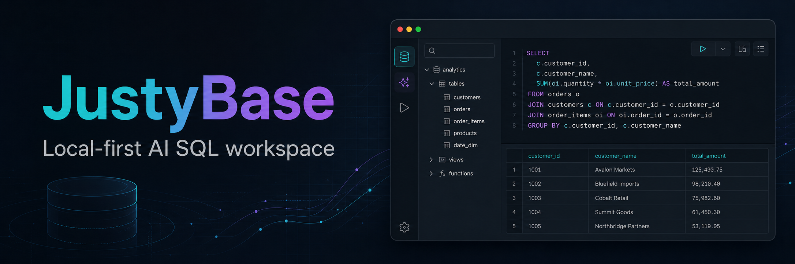
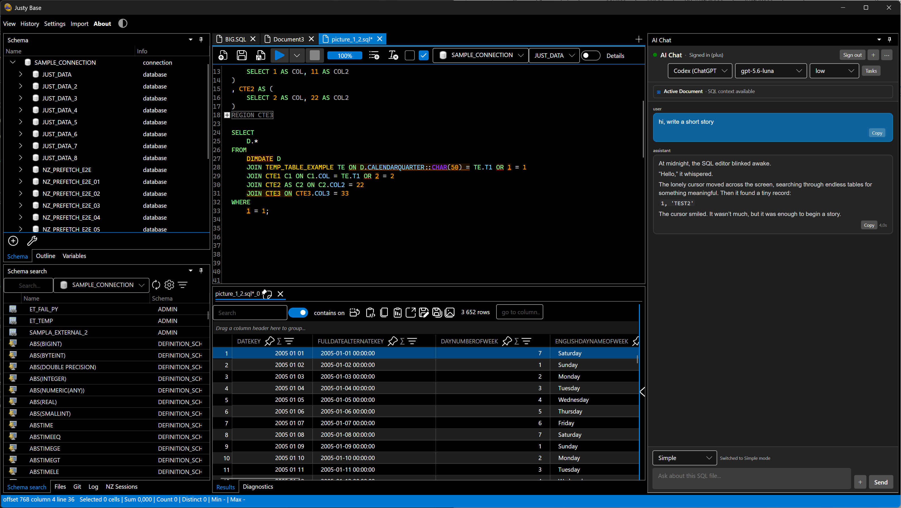
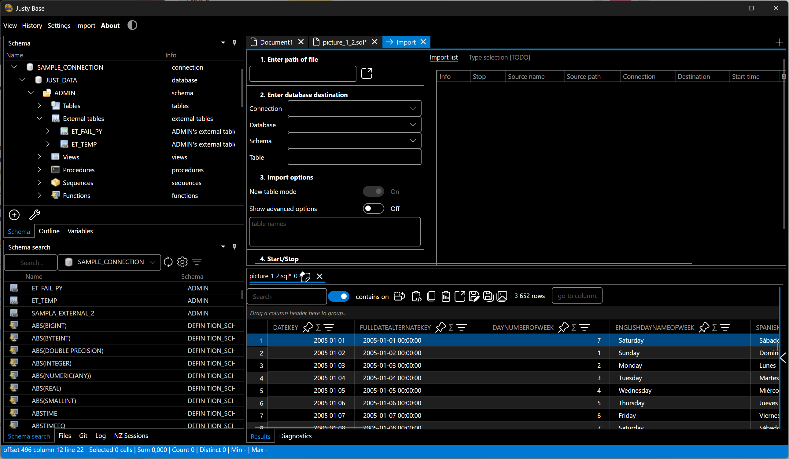
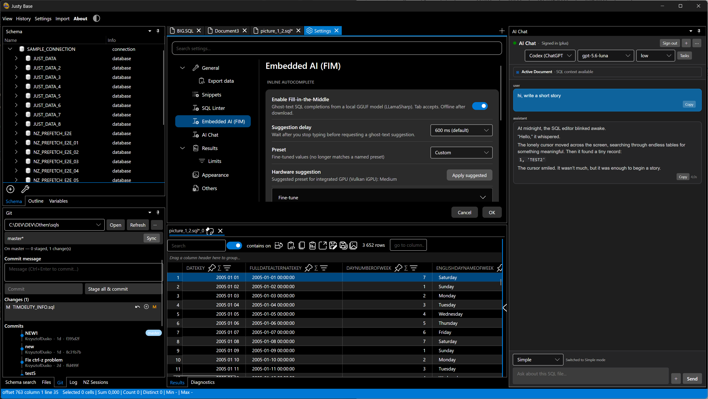
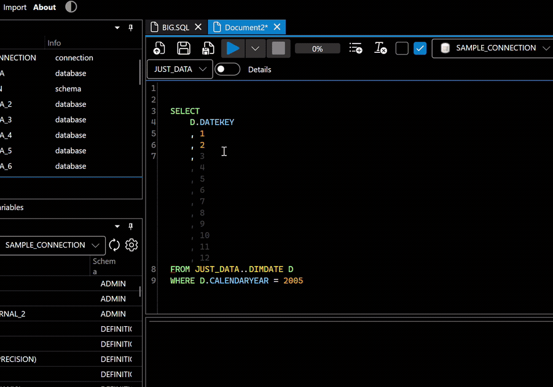
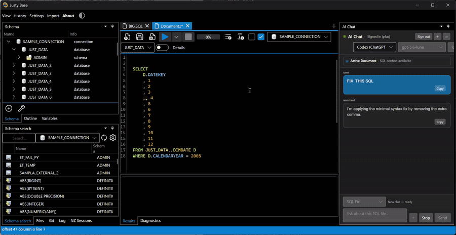
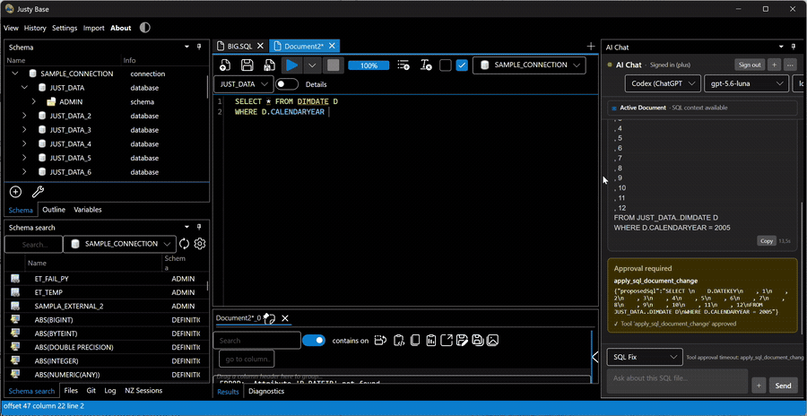

# JustyBase

<p align="center">
  
</p>

<p align="center">
  <strong>Local-first AI SQL workspace for IBM Netezza.</strong><br>
  A fast, privacy-minded desktop IDE for querying, exploring schemas, and shipping SQL.
</p>

[](https://github.com/justybase/justybase/actions/workflows/dotnet-test.yml)
[](LICENSE)
[](https://dotnet.microsoft.com/download/dotnet/10.0)
[](https://github.com/justybase/justybase/releases)
[](https://github.com/justybase/justybase/releases)
[](https://github.com/justybase/justybase/releases)

## Table of contents

- [Overview](#overview)
- [Why JustyBase](#why-justybase)
- [Features](#features)
- [Screenshots](#screenshots)
- [Workflow demos](#workflow-demos)
- [AI and data privacy](#ai-and-data-privacy)
- [Technology stack](#technology-stack)
- [Requirements](#requirements)
- [Quick start](#quick-start)
- [How to build](#how-to-build)
- [Quick verification](#quick-verification)
- [Tests](#tests)
- [Architecture](#architecture)
- [Download](#download)
- [Contributing](#contributing)
- [License](#license)
- [Support](#support)

## Overview

JustyBase is a local-first, cross-platform SQL IDE for IBM Netezza. It brings together a powerful editor, schema exploration, Git-aware workflows, and optional on-device AI assistance—without forcing your SQL workflow into the browser.

## Why JustyBase

If you work with SQL in a desktop environment and want a tool that stays close to the database, keeps the workflow fast, and supports local AI-driven assistance, JustyBase is designed for that balance.

It is especially useful for:

- fast exploratory querying on Netezza,
- interactive schema inspection,
- Git-backed SQL file workflows,
- local AI-assisted authoring and completion.

## Features

- **SQL editor** with syntax highlighting, folding, and autocomplete
- **Quick Open** via `Ctrl+P` for SQL files, docs, file roots, and known explorer paths
- **Embedded FIM AI** for local ghost-text SQL completions via a bundled llama.cpp llama-server (GGUF)
- **Git integration** with status, staging, history, diff, and commit workflow support
- **AI Copilot** for SQL help using Codex/ChatGPT, any OpenAI-compatible endpoint, or an embedded local GGUF model
- **Data grid** with grouping, filtering, and export to Excel, CSV, and Parquet
- **Multi-connection management** for multiple database sessions
- **Netezza-first database support** for IBM Netezza Performance Server
- **Excel File SQL** for `.xlsx` and `.xlsb` workbooks, with each worksheet exposed as a SQL table and exports to separate `.xlsx`/`.xlsb` result tabs
- **Microsoft Access** `.mdb`/`.accdb` support through the local pure-.NET UCanAccess provider and a dedicated Access SQL dialect
- **Other database engines** (Postgres, DB2, Oracle, DuckDB, MySQL) remain experimental or work in progress; SQLite is supported for native browsing, SQL execution, and SQLite-specific DDL/diagnostics
- **Self-contained ReadyToRun** release packages for deployment without a separately installed .NET runtime

> The hierarchical DataGrid is provided by the official `ProDataGrid` NuGet package and is restored automatically during the normal build.

> [!WARNING]
> **DB2 support is highly experimental — do not use it in production.** It is based on the prerelease `JustyBase.Db2` managed .NET driver (`0.1.0-alpha.1`) and its optional `JustyBase.Db2.IBMCompat` compatibility layer. The compatibility layer implements only a selected subset of IBM's `IBM.Data.Db2` API; it is not a complete or binary-compatible replacement for IBM's provider. The driver targets Db2 LUW, and protocol/platform coverage is limited and must be validated against your own server and workload. Expect connection, query, metadata, or bulk-import failures; do not use production databases or credentials, and always verify generated DDL scripts before running them elsewhere.

## Screenshots

Dark theme screenshots are shown below for a consistent presentation.

<p align="center">
  
</p>

| Import workflow | Settings |
|---|---|
|  |  |

## Workflow demos

### Local ghost-text completion



### AI-assisted SQL workflow



### Results exploration and filtering



## Technology stack

* [Avalonia](https://avaloniaui.net/) — cross-platform .NET UI
* [Dock](https://github.com/wieslawsoltes/Dock) — docking layout
* [ProDataGrid](https://github.com/wieslawsoltes/ProDataGrid) — high-performance DataGrid (NuGet 12.0.5)
* [AvaloniaEdit](https://github.com/AvaloniaUI/AvaloniaEdit) — Avalonia-based text editor (port of AvalonEdit)
* [SpreadSheetTasks](https://github.com/justybase/SpreadSheetTasks) — Excel I/O
* [Sylvan CSV](https://github.com/MarkPflug/Sylvan) — fast CSV
* [llama.cpp](https://github.com/ggml-org/llama.cpp) — bundled `llama-server` for embedded FIM and chat (GGUF)
* [Velopack](https://velopack.io/) — Windows installation and desktop updates from GitHub Releases

## Requirements

- **.NET 10.0 SDK**
- **Windows x64**, **Linux x64**, **macOS ARM64**
- NuGet access to restore **ProDataGrid 12.0.5**

## Quick start

```bash
# 1) Clone the repository
git clone https://github.com/justybase/justybase.git
cd justybase

# 2) Restore, build, and run
dotnet restore JustyBase.slnx
dotnet build JustyBase.slnx -c Debug
cd source/JustyBase
dotnet run
```

Builds require the sibling checkouts `../JustyBase.NetezzaSql` and `../JustyBase.UCanAccessCs`; place both next to this repository before restoring the solution. The GitHub Actions workflow definitions check them out next to `JustyBase` before restore/build.

On first launch, add an IBM Netezza connection from the schema or connections UI, open a SQL document, and execute a query. Other database connectors are under active development and are not part of the current support commitment.

### Dependencies

| Dependency | How it is resolved |
|------------|--------------------|
| **ProDataGrid** | NuGet package `ProDataGrid` version `12.0.5`. |
| **Netezza SQL libraries** | Required `../JustyBase.NetezzaSql` sibling, referenced as projects for parser, DDL, catalog, core, import/export, and AI libraries. `JustyBase.NetezzaDriver` remains a separate NuGet dependency. |
| **JustyBase.UCanAccessCs** | Required `../JustyBase.UCanAccessCs` sibling, referenced by `AccessPlugin` for `.mdb`/`.accdb` execution and optional encrypted-ACCDB support. Its parser dependency also points to the local Netezza parser project. |
| **JustyBase.Db2** | NuGet packages `JustyBase.Db2` + `JustyBase.Db2.IBMCompat`, restored from NuGet (default `0.1.0-alpha.1`; pin with `-p:JustyBaseDb2PackageVersion=...`). No local sibling checkout. |
| **GitHub Copilot CLI** | Required for the Copilot AI-chat backend. The app resolves `copilot` from `PATH` (or `JUSTYBASE_COPILOT_COMMAND`) and does **not** bundle it: `JustyBase.Ai` defaults to `CopilotSkipCliDownload=true` and the packaging scripts pass it explicitly, so no ~200 MB Copilot runtime is shipped. When the CLI is missing, the AI Chat panel shows an install hint with a **Check again** button. Install with `winget install GitHub.Copilot` (Windows) or `npm install -g @github/copilot` (all platforms). |

### AI and data privacy

AI features are opt-in and disabled by default. The application supports two local/offline paths and several provider-backed chat paths:

- **Embedded FIM** downloads a user-selected GGUF model from the documented model source and runs inference locally through a bundled llama.cpp `llama-server` subprocess. SQL text used for a suggestion stays on the workstation after the model is downloaded.
- **Embedded AI Chat** hosts a user-selected GGUF chat model (Qwen 3.5/3.6, Gemma 4, Devstral 2) on a second bundled `llama-server` subprocess, with tool calling / agent loop supported.
- **OpenAI Compatible** sends chat prompts and the SQL context selected by the application to the user-configured local endpoint (LM Studio, Ollama `/v1`, llama.cpp, vLLM, …). Their privacy and retention depend on that local service and its configuration.
- **Codex (ChatGPT)** starts the official Codex CLI app-server and uses the user's existing Codex/ChatGPT authentication. The app does not request or persist an OpenAI API key, but the active SQL document and selected metadata can be sent to the provider as part of a chat request.
- **Copilot (GitHub Copilot)** drives a separately installed GitHub Copilot CLI over stdio. The application does not ship the Copilot runtime: the released packages skip the SDK's CLI download (`CopilotSkipCliDownload=true`) and resolve `copilot` from `PATH` (or `JUSTYBASE_COPILOT_COMMAND`). If no CLI is found, the backend reports "Copilot CLI was not found".

The application does not expose arbitrary workspace file reads or result-grid rows to the AI tools. SQL execution and document changes require explicit approval in the UI. Credentials are stored in the application's protected local data store; users should still avoid sending confidential SQL or schema information to any remote provider unless their organization's policy permits it. See [docs/EMBEDDED_FIM.md](docs/EMBEDDED_FIM.md), [docs/EMBEDDED_CHAT.md](docs/EMBEDDED_CHAT.md) and [docs/AI_CHAT_CODEX.md](docs/AI_CHAT_CODEX.md) for complete model and provider details.

## How to build

### Standard build

```bash
dotnet build JustyBase.slnx -c Release
```

### Publish variants

Release packaging produces one full database/runtime variant per platform:

- `aot-self-contained` (Windows): self-contained **Native AOT** build (`PublishAot=true`, `PublishTrimmed=true`, `PublishReadyToRun=false`). The packaging machine needs the Visual Studio C++ x64 build tools (`Microsoft.VisualStudio.Component.VC.Tools.x86.x64`); `scripts/package-windows.ps1` locates them via `vswhere` and imports the `vcvars64` environment.
- `self-contained` (Linux/macOS): self-contained **ReadyToRun** build (`PublishAot=false`, `PublishReadyToRun=true`, `PublishTrimmed=false`).

Manual Windows AOT publish:

```bash
cd source/JustyBase
dotnet publish -r win-x64 -c Release -f net10.0 \
  -p:PublishAot=true -p:PublishTrimmed=true -p:PublishReadyToRun=false \
  --self-contained true
```

Manual Linux/macOS ReadyToRun publish:

```bash
cd source/JustyBase
dotnet publish -r win-x64 -c Release -f net10.0 \
  -p:PublishAot=false -p:PublishReadyToRun=true -p:PublishTrimmed=false \
  --self-contained true
```

Examples:

```text
publishWindows.bat <version>
./publishLinux.sh <version> artifacts
./publishMacOS.sh <version> osx-arm64 artifacts
```

The GitHub Actions release workflow builds a self-contained Native AOT package on Windows and self-contained ReadyToRun packages on Linux/macOS. Dynamic plugins and reflection-heavy database providers remain in-process. The closed-source DataGrid assembly is preserved with `TrimmerRootAssembly` (see `source/JustyBase/JustyBase.csproj`), and trimming is disabled on Linux/macOS for provider compatibility.

Windows installations created with Velopack automatically check the JustyBase GitHub Releases feed once per 24 hours, including prereleases. Updates download in the background and ask before restarting the application. The manual **Check for updates** command is available from the main window. Development runs and the Linux/macOS ZIP distributions do not perform automatic updates.

Netezza SQL and UCanAccess sources are required sibling checkouts for local builds. The GitHub Actions workflow definitions place both repositories next to `JustyBase` before restore/build; no NuGet fallback is used for these libraries.

## Quick verification

```bash
dotnet build .\source\JustyBase\JustyBase.csproj -c Debug
# Launch the app once, connect to a Netezza instance, and then run the live verification test if needed.
dotnet test .\source\JustyBase.LiveTests\JustyBase.LiveTests.csproj -c Debug --filter FullyQualifiedName~ReadmeSqlResultsHero
```

For more details, see [docs/TESTING.md](docs/TESTING.md).

## Tests

```bash
dotnet test source/JustyBase.Tests/JustyBase.Tests.csproj
dotnet test source/JustyBase.HeadlessTests/JustyBase.HeadlessTests.csproj
```

Coverage is published as a CI artifact in Cobertura format. CI status is shown above. For optional live Netezza validation, see [docs/INTEGRATION_TESTS.md](docs/INTEGRATION_TESTS.md).

## Architecture

- Short architectural overview: [docs/ARCHITECTURE.md](docs/ARCHITECTURE.md)
- Engine and plugin maturity matrix: [docs/PLUGIN_CAPABILITIES.md](docs/PLUGIN_CAPABILITIES.md)

## Download

Pre-built releases are available on the [GitHub Releases page](https://github.com/justybase/justybase/releases).

## Contributing

For contribution guidelines and development workflow details, see [CONTRIBUTING.md](CONTRIBUTING.md).

## License

This project is licensed under the MIT License. See [LICENSE](LICENSE) for details.

## Support

- [GitHub Issues](https://github.com/justybase/justybase/issues)
- Active project development and ongoing maintenance
