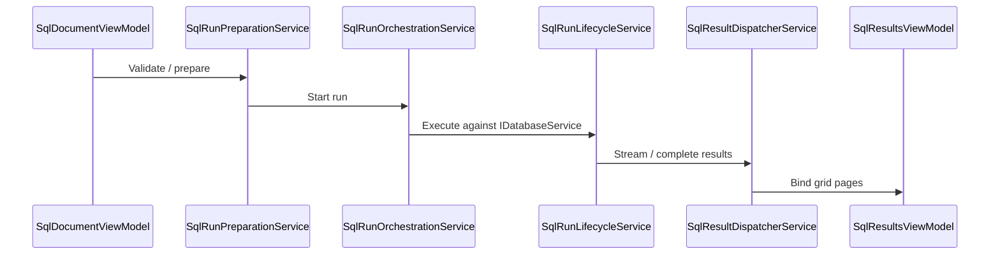

# Architecture

JustyBase is an Avalonia desktop SQL IDE with a plugin-based database layer.

## Layers

```text
JustyBase (UI host: Views, ViewModels, app services)
  ├─ SqlEditor.Avalonia          # SQL editor control (+ optional FIM ghost text)
  ├─ JustyBase.Ai.Embedded       # Embedded llama.cpp (llama-server) models & subprocesses
  ├─ JustyBase.Common            # config, contracts, shared models
  ├─ JustyBase.PluginCommon      # IDatabaseService and plugin contracts
  ├─ JustyBase.PluginBase        # DatabaseService base + plugin loader
  └─ Plugins/*                   # Netezza, Excel File SQL, Access, Postgres, MySQL, ...
```

External:

- **ProDataGrid** — NuGet dependency for DataGrid / hierarchical schema tree (MIT, resolved from nuget.org only)
 - **JustyBase.NetezzaSql** — required sibling projects for parser, DDL, catalog SQL, core, import/export, and AI
 - **JustyBase.UCanAccessCs** — required sibling provider used by `AccessPlugin`; it references the sibling Netezza parser project

## UI composition

- **MVVM** with CommunityToolkit.Mvvm and Dock documents/tools
- **DI** via `Microsoft.Extensions.DependencyInjection` (`ServiceCollectionExtensions`)
- Views are resolved by `ViewLocator` (constructor injection preferred over service locator)

## Embedded AI (optional)

Local **Fill-in-the-Middle** SQL ghost text — served by a bundled llama.cpp `llama-server` subprocess — and the same FIM server for **Git commit message** drafts (plain completion, not FIM tokens). A second llama-server subprocess hosts the **Embedded (local)** AI chat backend with tool calling.

- User guide: [EMBEDDED_FIM.md](EMBEDDED_FIM.md)
- Interface: `ICompletionProvider` in `JustyBase.Ai.Embedded`; commit messages via `IGitCommitMessageAiService`
- Editor: `InlineCompletionController` (configurable debounce, Tab accept)
- Settings (`AppOptions`): `EnableFimServer` / `EnableEmbeddedChatAi` (default off), model ids / presets / delay / GPU knobs (see EMBEDDED_FIM.md)
- Models downloaded to `%LOCALAPPDATA%/JustyBase/models/`; llama-server binary to `%LOCALAPPDATA%/JustyBase/llama-server/`
- The engine is an external native process, so it has no impact on the JustyBase managed process

## Git tool

Dock tool for local Git repos: status, stage/commit, pull/push/sync, branches, history/timeline, and a non-floating **Diff** document for file previews.

## SQL run flow (simplified)



## Result storage and spill

Decoded rows are held under a shared `ResultMemoryBudget` (4 GiB by default) and
per-result row cap. When a result exceeds `ResultSpillThreshold` (250,000 rows by
default) or the budget cannot serve the next row, loading switches to a typed
SQLite spill file and the grid pages from disk. Sorting, search and column
filters run in SQL against the spill on a worker thread; grouping materializes the
filtered result only when it fits the budget and stays below one million rows.

Export and "copy all rows" stream every filtered row from the spill through a
`SpillResultReader`, so they are never limited to the visible page.

The application-wide spill quota (2 GiB) is enforced per write; a full quota
keeps already-written rows and reports the limit instead of discarding results.
A shared LRU page cache keeps scrolling cheap, and orphaned spill files from dead
processes are removed at startup.

Details and settings: [RESULT_STORE.md](RESULT_STORE.md).

## Plugins

Each engine plugin:

1. Inherits `DatabaseService`
2. Declares `public const DatabaseTypeEnum WHO_I_AM_CONST = ...`
3. Implements dialect-specific DDL/schema helpers behind `IDatabaseService` (composed of smaller contracts)

Connection instances are owned by `DatabaseServiceRegistry` (DI singleton; also reachable via `IDatabaseServiceResolver`). Static `DatabaseServiceHelpers` remains for driver-name maps and plugin registration.

Runtime plugins can also load from the plugins directory when configured.

Maturity by engine: [PLUGIN_CAPABILITIES.md](PLUGIN_CAPABILITIES.md).

## Cross-cutting

- Credentials stored encrypted under `%AppData%\JustDataEvo`
- Logging redacts connection secrets
- Windows update integration uses Velopack's `GithubSource` against the public JustyBase GitHub Releases feed. Automatic checks are throttled to once per 24 hours and downloaded updates require user confirmation before restart. Full and Slim builds share the `JustyBase` package id and are separated by the `win` / `win-slim` channels; Settings can switch an installed copy to the other variant (explicit channel with downgrade allowed, applied on restart).
 - Release artifacts: Windows is self-contained Native AOT (`PublishAot`/`PublishTrimmed`), Linux/macOS stay self-contained ReadyToRun (no trimming); workflow definitions check out both sibling repositories before restore/build, with no NuGet fallback for their libraries
